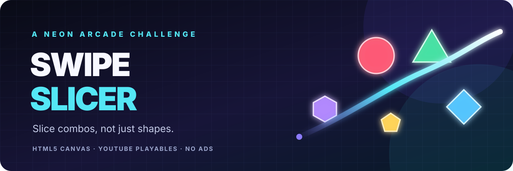

<p align="center">
  
</p>

<p align="center">
  
  
  
  
</p>

<h1 align="center">Swipe Slicer</h1>
<p align="center"><strong>Slice combos, not just shapes.</strong><br>A tactile neon arcade game built around color-chain skill, not random swiping.</p>

<p align="center">
  <a href="https://developers.google.com/youtube/gaming/playables/reference/sdk">Playables SDK</a> ·
  <a href="https://developers.google.com/youtube/gaming/playables/certification/requirements">Certification requirements</a> ·
  <a href="https://developers.google.com/youtube/gaming/playables/test_suite">Official test suite</a>
</p>

---

## ✦ The game

Shapes rise from the bottom in fizzy, physics-driven volleys. Swipe through them in a single continuous movement and keep the same color flowing to grow your chain. Color changes break the chain; a rare **Prism** shape bridges colors, and a six-shape chain triggers **Chromatic Fever** for four seconds of double points.

| Feature | How it plays |
|---|---|
| **Color-chain scoring** | Same-color shapes in one swipe build a larger chain bonus. Lift to bank your score. |
| **Chromatic Fever** | Reach a chain of 6 to activate a short double-score burst. |
| **Prism wildcard** | Rare rainbow prisms link your current chain into the next color. |
| **Daily visual theme** | Shape sets rotate by UTC date; the physics and rules stay familiar. |
| **Risk / reward** | Slice a bomb and the run ends. Let 3 regular shapes escape and the run ends. |
| **Juicy feedback** | Neon slash trail, spin, glow, burst particles, combo callouts, satisfying slice sounds, and screen shake for big chains. |
| **Progress** | Best score, longest chain, total slices, runs played, and 8× / 12× / 16× chain medals are tracked. |
| **Responsive play** | Mouse, touch, keyboard pause/resume, safe-area-aware UI, and resize-preserved game state. |

## 🎮 Controls

| Input | Action |
|---|---|
| Touch + drag | Slice shapes |
| Mouse click + drag | Slice shapes |
| `P` or `Esc` | Pause / resume during a run |
| `Enter` or `Space` | Start from the title screen |

**Quick tip:** plan one smooth route through a volley. A precise chain is worth much more than several isolated slices.

## 🧪 Run locally

No package install or build step is required.

1. Download or clone the repository.
2. Open `index.html` in a modern browser, or serve the folder with any static web server.
3. Press **Start slicing** and drag through shapes.

When hosted outside YouTube, the game uses browser storage for local progress. When running inside the Playables environment, it uses the Playables cloud-save APIs and does not fall back to browser storage for game progress.

## ▶ YouTube Playables integration

The root `index.html` imports the SDK before all game code:

```html
<script src="https://www.youtube.com/game_api/v1"></script>
```

The current build includes the following integrations:

| Integration | Implementation |
|---|---|
| First frame | Calls `ytgame.game.firstFrameReady()` after the first rendered canvas frame. |
| Ready state | Calls `ytgame.game.gameReady()` after save/language initialization and when the menu is interactive. |
| Environment detection | Checks `ytgame.IN_PLAYABLES_ENV`. |
| Cloud saves | Loads versioned data before saving, writes only through `saveData()` in Playables, and accepts older save fields. |
| Audio | Reads `isAudioEnabled()`, updates from `onAudioEnabledChange()`, and suspends audio during pauses. |
| Lifecycle | Registers `onPause()` / `onResume()`, suspends the loop and audio while paused, and saves progress on pause. |
| Score | Submits the best score through `sendScore()` only after the same best score has been saved successfully. |
| Health | Reports runtime errors and SDK integration warnings when the health APIs are available. |
| Responsive viewport | Full-viewport canvas, high-DPI backing store, safe-area UI, and coordinate-preserving resize handling. |

### Resolution and aspect ratio

There is **no single fixed Playables resolution to target**. The game uses the viewport it is given and is designed to resize without restarting the run. YouTube's current design guidance calls out extreme and common ratios including **9:32, 9:21, 9:16, 3:4, 1:1, 4:3, 16:9, 21:9, and 32:9**. The canvas fills the available viewport, scales its backing store for high-density displays, and adapts HUD spacing to screen width. Device orientation is not locked.

### Certification / test checklist

- [x] `index.html` is at the project root.
- [x] SDK script loads before game code.
- [x] First-frame and interactable-ready notifications are wired in order.
- [x] Pause/resume and audio-setting callbacks are wired.
- [x] Cloud data is loaded before any cloud save attempt.
- [x] Game data stays far below the 3 MiB save limit; initial HTML is far below the 30 MiB bundle limit.
- [x] Responsive canvas, touch and mouse input, and keyboard pause/resume are implemented.
- [x] No ad, rewarded-ad, interstitial-ad, or payment integration is included.
- [ ] Run the official YouTube Playables Test Suite with the uploaded build.
- [ ] Complete Developer Portal metadata and the review / release process.

The local smoke test validates package structure, SDK script ordering, the presence of core integration hooks, responsive viewport support, and the absence of monetization API calls. **It does not replace the official YouTube Test Suite or guarantee certification.**

## 🛠 Development and testing

Requires Node.js 20 or newer for the small built-in smoke test. The game itself has **zero runtime dependencies**.

```bash
npm test
```

Manual test cases are in [`docs/PLAYABLES_CHECKLIST.md`](docs/PLAYABLES_CHECKLIST.md). The smoke test runs locally and in GitHub Actions.

## 💡 Ideas for the next update

1. **Daily seeded challenge** — identical shape order each UTC day, with a local best-of-day score.
2. **More shape families** — petals, moons, ring shapes, and seasonal visual packs, with no change to hitbox rules.
3. **Challenge badges** — add no-miss time milestones, flawless daily runs, and a permanent achievement shelf.
4. **Practice mode** — slower launch rate and no bombs, separate from the saved arcade score.
5. **Accessibility options** — optional color-independent pattern markers, reduced-motion setting, and larger HUD mode.
6. **Replay ghost** — a lightweight replay of the previous best run using recorded input points.

These are suggestions only; the current game intentionally keeps its core loop quick and dependency-free.

## 📁 Project layout

```text
.
├── index.html                     # Game + Playables SDK integration
├── README.md                      # Project overview and setup
├── package.json                   # npm test shortcut; no dependencies
├── tests/
│   └── smoke-test.cjs             # Static and mocked-SDK smoke checks
├── docs/
│   ├── swipe-slicer-hero.svg      # README artwork
│   └── PLAYABLES_CHECKLIST.md     # Manual QA matrix
└── .github/workflows/
    └── smoke-test.yml             # CI smoke checks
```

---

<p align="center"><sub>Made for fast rounds, clean swipes, and satisfying chains. No ads. No framework. Just play.</sub></p>